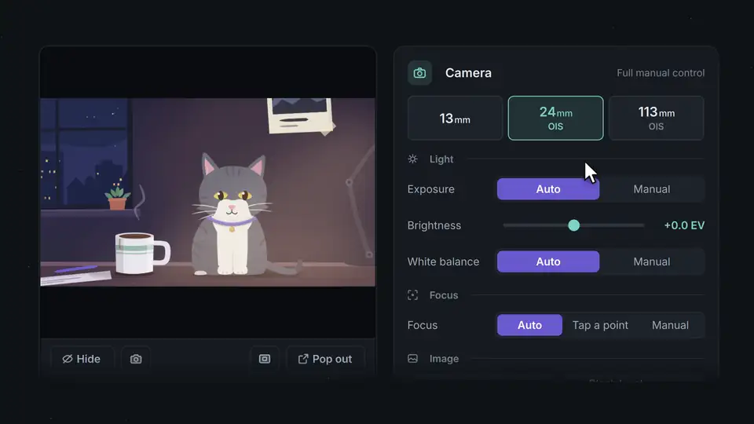
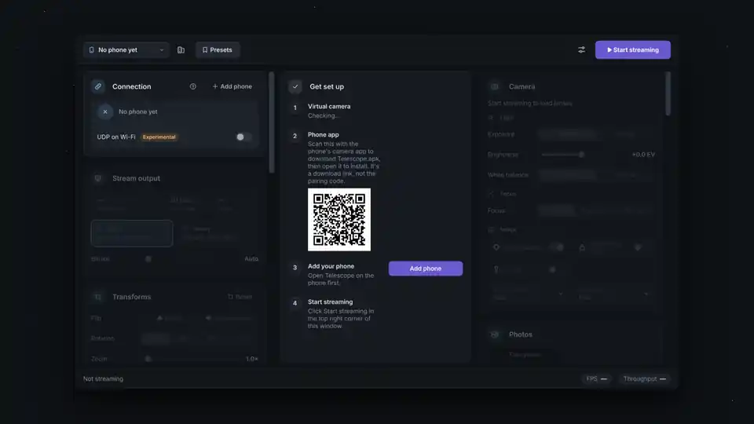
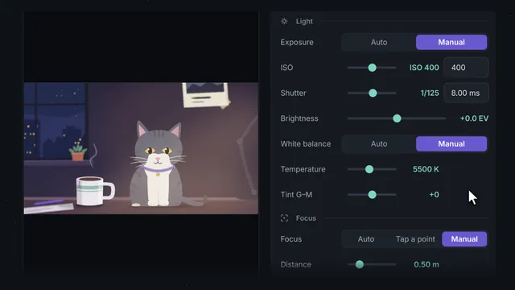
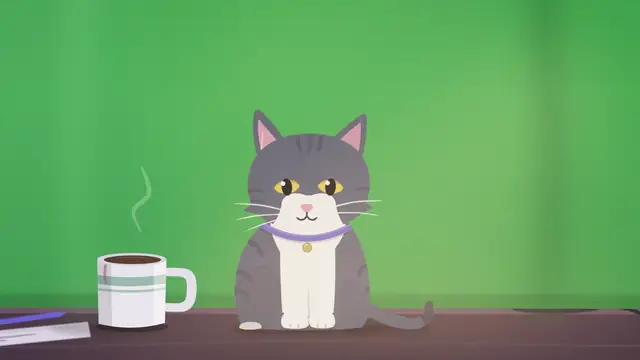
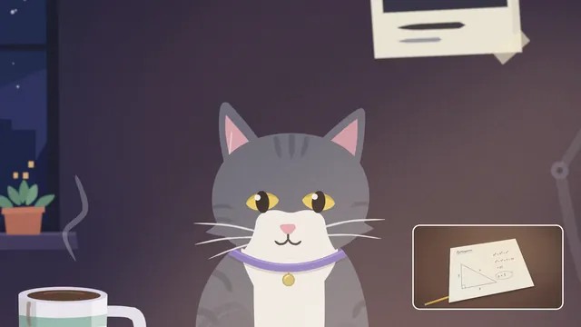
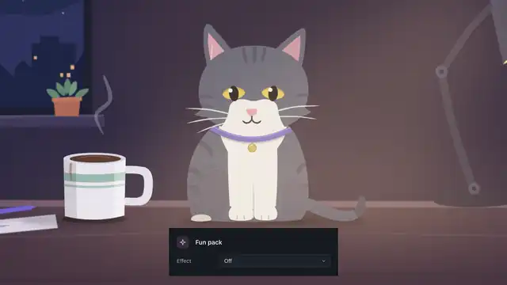

  
  
  
  

Telescope turns your Android phone into a webcam for your Linux or Windows computer. Every lens on it works, from the ultra-wide to the telephoto, and it's free with no watermark, no ads and no account.

  
  
  

## Up and running in about two minutes

1. **Get the desktop app.** On Windows run `TelescopeSetup.exe` (it installs only for your user and needs no admin). On Linux extract the tarball and run `./start.sh`.
2. **Follow the checklist it opens with.** It sets up the virtual camera, puts the phone app on your phone with a QR code and pairs the two.
3. **Pick the camera in your app.** It's called **Telescope** on Windows and **Phone Camera** on Linux, in Discord, Zoom, OBS or anything else that takes a webcam.

What Linux needs

- **Python 3.12 or newer**
- **`v4l2loopback`** from your distro, for the virtual camera (`sudo apt install v4l2loopback-dkms` on Debian and Ubuntu, `sudo dnf install v4l2loopback` on Fedora with [RPM Fusion](https://rpmfusion.org/))
- **`adb`** only if you want USB. Wi-Fi works without it

[Manual setup](docs/setup.md#linux) has the rest, including Ubuntu 22.04's older Python.

No Android phone? [Browser camera](docs/features.md#browser-camera) streams from an iPhone, a tablet or an old laptop straight from its browser with nothing to install.

## More than a webcam

Plug the phone in or use Wi-Fi and run up to four phones at once, each as its own webcam. The phone's mic can be your microphone too.

<table>
  <tr>
    <td width="33%"> <b>Pro controls</b> ISO, shutter, focus and white balance by hand, like the Pro mode in your phone's camera app.</td>
    <td width="33%"> <b>Auto framing</b> Zooms and pans to keep you in the shot.</td>
    <td width="33%"> <b>Background and Chroma key</b> Blur the room or swap it out, with or without a green screen.</td>
  </tr>
  <tr>
    <td> <b>Several cameras in one picture</b> Your face big and the desk in a corner, for apps that take one camera.</td>
    <td> <b>Desk mode</b> Point the phone at a sheet of paper and calls see it flat.</td>
    <td> <b>Fun pack</b> Clone party, an invisibility cloak, VHS, a 1998 webcam and lots more.</td>
  </tr>
</table>

Most of these are plugins you switch on when you want them, along with Colour grading, Privacy blur, a Name tag, Notes next to the lens and others. You can install plugins other people made too.

[Everything Telescope can do](docs/features.md) is in the docs, along with [how it compares](https://telescope.webcam/compare.html) with DroidCam, Iriun and Camo.

## Questions people ask

<b>Is it actually free?</b>

Yes. Every feature, every resolution, no watermark, no ads. If you'd like to chip in anyway, there's [Ko-fi](https://ko-fi.com/lunarkittyy).

<b>Does my video go through someone's server?</b>

No. It goes straight from the phone to your computer, over USB or your own network, encrypted with TLS. There's no account and no cloud, and the apps only go online to check GitHub for updates, or to fetch adb or VB-Cable from Google or VB-Audio when you ask for them. Use it only on a network you trust or switch on **Local only - USB** in the Android app. Details in [Privacy](docs/features.md#privacy).

<b>Will it work with Discord / Zoom / Teams / OBS / my browser?</b>

If it can use a webcam, yes. Telescope shows up there as an ordinary camera and you pick it like any other one.

<b>I have an iPhone or a Mac.</b>

The phone app is Android only, but [Browser camera](docs/features.md#browser-camera) streams from an iPhone's browser with nothing to install. The desktop app runs on Windows and Linux, not macOS.

<b>Will it work on my phone?</b>

It needs Android 8 or newer. [Device compatibility](docs/device-compatibility.md) lists what's been tested. If you try it on a phone that isn't there, [let me know how it went](https://github.com/LunarKittyy/Telescope/discussions/new?category=device-compatibility). That's one of the most useful things you can do for the project.

<b>Rather not install anything on Windows?</b>

`Telescope-windows-portable.zip` on the [releases page](../../releases) has the same app. Extract it and run `TelescopeDesktop.exe`, keeping it in its folder since the `lib-...` folder next to it is part of the app.

<b>Is it made with AI?</b>

Yes, I use AI agents for a big part of the project. The code is generated but what Telescope does and how it should behave is my design, and testing on real hardware is also mostly done by me (automated tests aside).

Stuck, or have an idea? Ask in [Discussions](../../discussions). Found a bug? Open an [issue](https://github.com/LunarKittyy/Telescope/issues/new?template=bug.yml) with your **Copy diagnostics** report. [Troubleshooting](docs/troubleshooting.md) covers the common problems.

## Helping out

Device reports, bug reports with a diagnostics report and pull requests are all welcome. [CONTRIBUTING.md](CONTRIBUTING.md) has the details and [the docs](docs/README.md) explain how it's built.

Telescope is licensed under the [GNU Affero General Public License v3.0](LICENSE). [Licenses](docs/licenses.md) explains what that means for you and lists the third-party parts it uses.

<a href="https://www.star-history.com/#LunarKittyy/Telescope&Date">
  <picture>
    <source media="(prefers-color-scheme: dark)" srcset="https://api.star-history.com/svg?repos=lunarkittyy/telescope&type=Date&theme=dark" />
    <source media="(prefers-color-scheme: light)" srcset="https://api.star-history.com/svg?repos=lunarkittyy/telescope&type=Date" />
    
  </picture>
</a>
