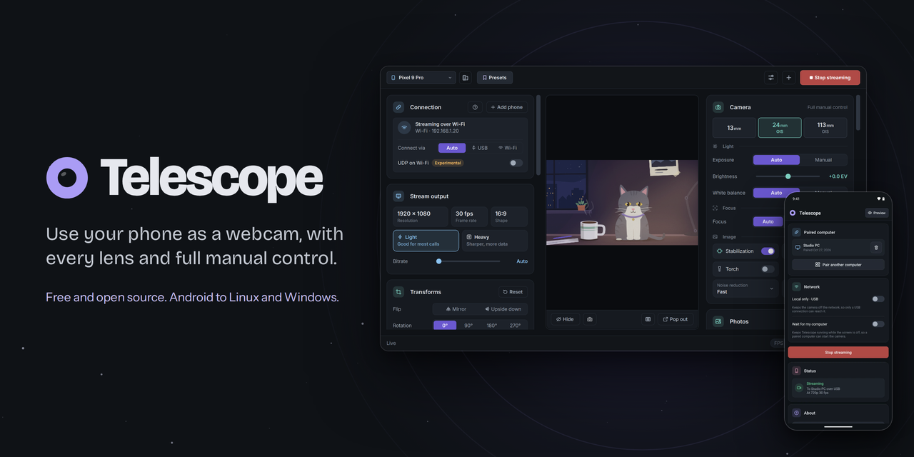
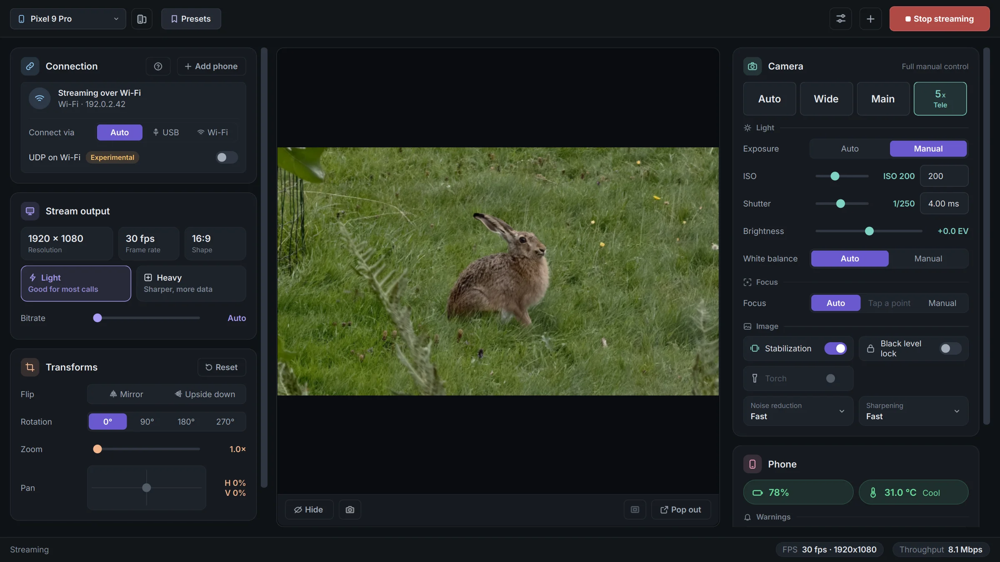

# Telescope

Telescope turns your Android phone into a webcam for your Linux or Windows computer, and lets you use any of its lenses like telephoto or ultra-wide.

- Shows up as a normal webcam in Discord, Zoom, OBS and anything else, and the phone's mic can be your [microphone](docs/features.md#microphone) too
- [Pick the lens](docs/features.md#camera-control), and set exposure, focus and white balance remotely from the computer
- Connects over [USB or Wi-Fi](docs/features.md#phones-pairing-and-connection), transfers data [encrypted](docs/features.md#privacy)
- Can [start streaming on its own](docs/features.md#system-integration) when an app opens the camera and stop again once nothing's using it
- A built-in [updater](docs/features.md#updates) lets you install new versions in one click

It's free, all of it: no watermark, no ads, no account, no Pro version. Here's [how it compares](https://telescope.webcam/compare.html) with DroidCam, Iriun and Camo.

## Quick Start

You'll need a PC running Linux or Windows and a phone. With the Android app you get every lens and full manual control. Without the app, [Browser camera](docs/features.md#browser-camera) streams from any phone, tablet or laptop straight from its browser with nothing to install.

### 1. 🖥️ Get the desktop app

**🪟 Windows**

Download `TelescopeSetup.exe` from the [releases page](../../releases) and run it. It installs only for your user and doesn't need admin.

Rather not install anything? `Telescope-windows-portable.zip` has the same app: extract it and run `TelescopeDesktop.exe` (keep it in its folder: the `lib-...` folder next to it is part of the app).

**🐧 Linux**

Download `Telescope-linux.tar.gz` from the [releases page](../../releases), extract it, and run `./start.sh`. It needs **Python 3.11 or newer** and the **`v4l2loopback`** package from your distro (what the virtual camera runs on). For USB you'll also want **`adb`**, but Wi-Fi works without it. [Manual setup](docs/setup.md#linux) has the install commands for each distro, plus fixes for Ubuntu 22.04's older Python and Fedora without RPM Fusion.

### 2. ✅ Follow the checklist

On first launch, the middle of the window is a checklist:

1. **Virtual camera** - on Windows, click **Install driver**. On Linux it checks for the package above and names it if it's missing.
2. **Phone app** - scan the code with your phone's camera to download `Telescope.apk`, then open it to install. (Your phone asks to allow "install from this source" the first time.)
3. **Add your phone** - open Telescope on the phone and click **Add phone**. Then tap **Scan pairing code** on the phone, or plug it in over USB and allow [USB debugging](https://developer.android.com/studio/debug/dev-options#enable) when the phone asks.
4. **Start streaming** - click **Start streaming** in the top right corner. The phone's camera wakes up on its own.

After the first stream, the checklist is replaced by the video.

### 3. 📷 Use it as a webcam

In OBS (or anywhere else), pick **Phone Camera** (Linux) or **Telescope** (Windows) as your webcam.

Telescope uses USB whenever the phone is plugged in and answering, and Wi-Fi otherwise. The Connection panel shows which one it's using, and if a cable is plugged in but not being used it tells you why. **Connect via** can force one or the other.

> [!NOTE]
> Use only on a trusted network, or enable **Local only - USB** in the Android app. See [Privacy](docs/features.md#privacy) for the full security model.

That's all most people need. The full feature list, troubleshooting and everything else is in [the docs](docs/README.md).

Stuck, or have an idea? Ask in [Discussions](../../discussions). Found a bug? Open an [issue](https://github.com/LunarKittyy/Telescope/issues/new?template=bug.yml) with your **Copy diagnostics** report.

## Questions people ask

<b>Is it actually free?</b>

Yes. Every feature, every resolution, no watermark, no ads. If you'd like to chip in anyway, there's [Ko-fi](https://ko-fi.com/lunarkittyy).

<b>Does my video go through someone's server?</b>

No. It goes straight from the phone to your computer, over USB or your own network, encrypted with TLS. There's no account and no cloud, and the apps only go online to check GitHub for updates, or to fetch adb or VB-Cable from Google or VB-Audio when you ask for them. Details in [Privacy](docs/features.md#privacy).

<b>Will it work with Discord / Zoom / Teams / OBS / my browser?</b>

If it can use a webcam, yes. Telescope shows up there as an ordinary camera and you pick it like any other one.

<b>I have an iPhone or a Mac.</b>

The phone app is Android only, but [Browser camera](docs/features.md#browser-camera) streams from an iPhone's browser with nothing to install. The desktop app runs on Windows and Linux, not macOS (yet?).

<b>Can I use more than one phone?</b>

Up to four at once, each its own webcam. Nice for a second angle in OBS.

<b>Will it work on my phone?</b>

It needs Android 8 or newer. [Device compatibility](docs/device-compatibility.md) lists what's been tested. If you try it on a phone that isn't there, [let me know how it went](https://github.com/LunarKittyy/Telescope/discussions/new?category=device-compatibility). That's one of the most useful things you can do for the project.

---

## Docs

- [Features](docs/features.md): everything Telescope can do
- [Troubleshooting](docs/troubleshooting.md): common problems and their fixes
- [Manual setup](docs/setup.md): the virtual camera and drivers by hand
- [All docs](docs/README.md), including the protocol and how it's built

## Helping out

Device reports, bug reports with a diagnostics report, and pull requests are all welcome. [CONTRIBUTING.md](CONTRIBUTING.md) has the details.

## License

Telescope is licensed under the [GNU Affero General Public License v3.0](LICENSE). [Licenses](docs/licenses.md) explains what that means for you and lists the third-party parts it uses.

## Star history

<a href="https://www.star-history.com/#LunarKittyy/Telescope&Date">
  <picture>
    <source media="(prefers-color-scheme: dark)" srcset="https://api.star-history.com/svg?repos=lunarkittyy/telescope&type=Date&theme=dark" />
    <source media="(prefers-color-scheme: light)" srcset="https://api.star-history.com/svg?repos=lunarkittyy/telescope&type=Date" />
    
  </picture>
</a>
