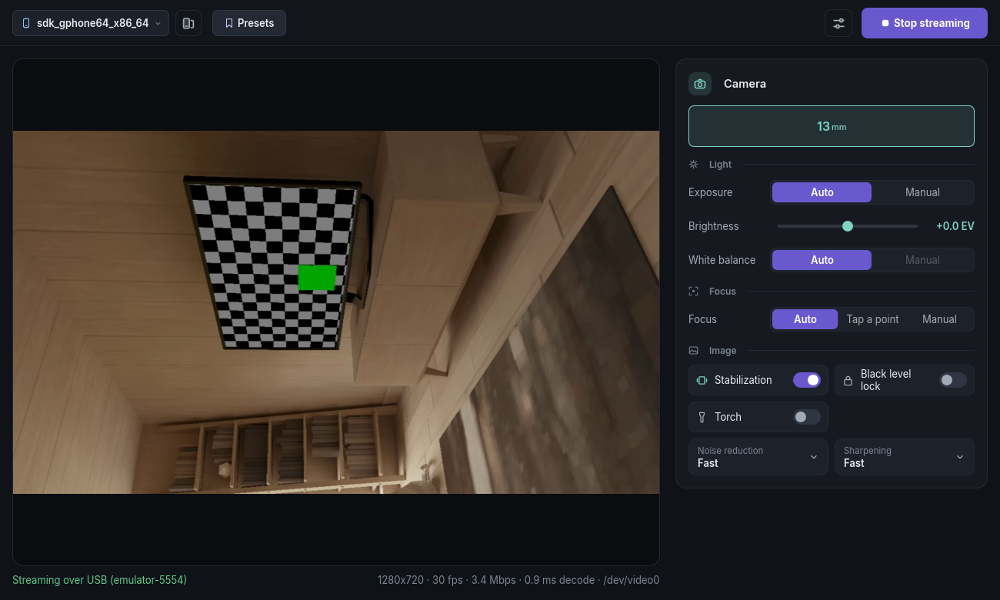
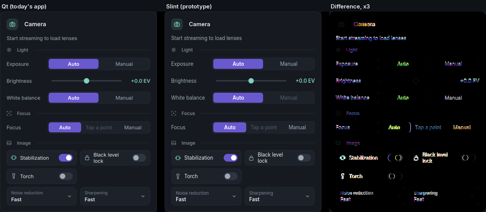
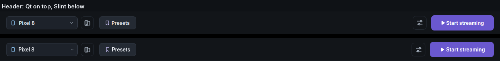
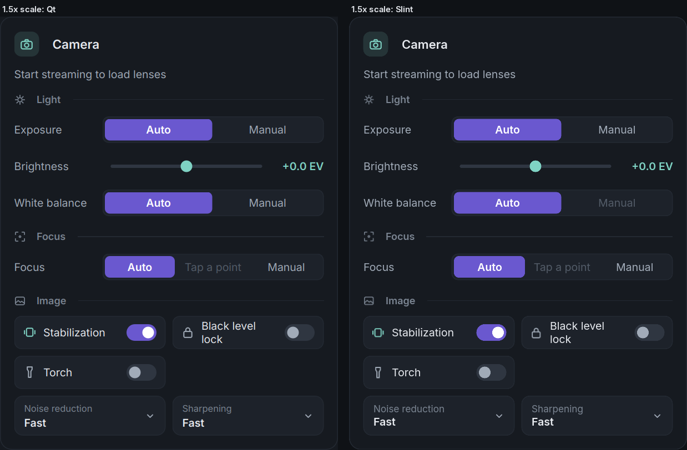

# Rust and Slint prototype: findings

A small Rust version of the desktop app, built to find out whether a full rewrite is worth it. It pairs with the unchanged Android app, starts a stream with the same protocol, decodes H.264 into a v4l2loopback camera and shows a Slint window with the preview, the header and the Camera card. Linux only, no plugins, no translations.

## Short answer

- **Look:** Slint matched the Qt Camera card and header to within a pixel or two, at 1x and at 1.5x. The Qt app paints its own widgets from QSS and custom `paintEvent`s anyway, which maps onto Slint well. What Slint lacks is the stuff around the cards (native file dialogs and message boxes, rich text with links, a battle-tested tray), not the cards themselves.
- **Speed and size:** startup to the first painted window drops from about 1.07 s to 65 ms, memory while streaming halves (145 MB against 290 MB RSS) and the binary is 18 MB. Streaming CPU barely changes (18.5% against 21%) because the Python app already decodes in FFmpeg's C code. A rewrite buys a much lighter app, not a much cheaper stream.
- **Verdict:** Slint is good enough for Telescope's look and I'd pick it over C++ with Qt, since C++/Qt keeps the heaviest part of today's download (Qt itself) and Slint only loses on things Telescope uses in a handful of places. The rewrite is still big and its expensive parts aren't the GUI (see the estimate at the end).

## What was tested and how

Nothing in `desktop/` or `android/` changed. The owner's phone wasn't plugged in and its app wasn't reachable over Wi-Fi. Two stand-ins did the work instead.

- **The real Android app on the emulator** (`./gradlew assembleDev` and the dev app installed on the `tscope_api36` emulator). `telescope-rs pair --usb` paired over adb (reverse tunnel plus the pairing broadcast), and both the headless stream and the window streamed its camera at 1280x720, 30 fps, into `/dev/video0`. `ffmpeg -f v4l2 -i /dev/video0` read the picture back. Three controls went through and showed up in `/v1/state` (`ae_comp` 0 to 3, `ois` on to off, `nr_mode` 1 to 2). The emulator's camera stops at 720p.
- **A fake phone** (`tools/fake_phone.py`) for the 1080p30 numbers. It serves the session and stream ports over TLS like the phone does, answers `/v1/state` with `docs/state.json` (minus the error and heat fields) and plays a 60 s 1080p30 High-profile clip at about 8 Mbps as `/v1/video.h264`. Both apps used it as an already-paired phone at `127.0.0.2` and got the same bytes. Python ran as the dev desktop (`main.py` with `TELESCOPE_DEV_PROFILE`, resuming the stream on start).

Not tested at all: mDNS discovery against a real phone (the code is there, the fake phone doesn't announce itself), Wi-Fi to a real phone, UDP video, the audio and sensor streams, and a real phone's 1080p encoder.



## Measurements

This machine: Ryzen 7 9800X3D, AMD graphics, Fedora (Nobara) with KDE on Wayland, FFmpeg 8.1. Each streaming row is 30 s sampled after 10 s of streaming, with `ffmpeg` reading the virtual camera the whole time the way a video call would. CPU is percent of one core and memory covers the whole process. `tools/measure.py` does all of it.

| | Rust window | Rust window, VA-API | Rust, no window | Python app |
|---|---|---|---|---|
| CPU at 1080p30 | 18.5% (18.6% on a second run) | 11.8% | 10.2% | 21.4% (20.4%) |
| Memory, RSS | 145 MB | 141 MB | 50 MB | 287 MB (290 MB) |
| Memory, PSS | 90 MB | 87 MB | 34 MB | 239 MB (242 MB) |
| Frames the camera delivered in 35 s | 1066 | 1066 | 1065 | 1066 |
| Start to first painted window (median of 5) | 65 ms | | | 1072 ms |

- About 8 of the Rust window's 18.5 points are the preview. Each frame gets scaled and converted to RGB on the processor, uploaded and the whole window redrawn. Drawing the YUV frame as a texture on the graphics card would take most of that away.
- The Python app does more per frame than the prototype (BGR conversion for the plugin pipeline, every built-in plugin loaded), which is part of why its CPU is higher. The comparison is fair on what the user sees, not on code paths.
- Python's start time is to its main window. Its splash shows earlier than that.
- 1066 frames in 35 s is 30.5 fps, the reader's own timing being a little loose. No app dropped frames.

### Size

| | Size |
|---|---|
| `telescope-rs`, stripped release (opt-level 3, thin LTO) | 18.4 MB |
| Same at opt-level `s` | about 16 MB (14.8 MB measured before AccessKit went in) |
| Python app's Linux packages on disk (PyQt6 262 MB, PyAV 108 MB, OpenCV 164 MB, the rest about 30 MB) | about 565 MB |
| Python app for Windows today | 104 MB installer, 141 MB portable zip |

The binary links the system's FFmpeg (Fedora's `libavcodec` alone is 14 MB because it carries every codec). The 18.4 MB is Slint with the femtovg renderer, winit with both Wayland and X11, the text stack, the SVG renderer for icons, rustls, mDNS and AccessKit for screen readers (1.4 MB of it).

A Windows build would land around 20 to 25 MB unpacked. That's the binary (a bit smaller than on Linux without the Wayland and X11 clients) plus either a minimal static FFmpeg with just the H.264 decoder, swscale and D3D11VA (2 to 4 MB) or Windows' own H.264 decoder through Media Foundation (nothing extra), plus the existing camera DLL and UnityCapture. An installer for that should be 10 to 15 MB against today's 104 MB. That doesn't count the parts the prototype leaves out, like the Browser camera's WebRTC stack and the vision pack (which is already a separate download).

## How the pieces were chosen

- **Decoding: FFmpeg's libavcodec** through `ffmpeg-sys-next`, the same decoder PyAV wraps, with the same low-delay flag. It handles every profile phones send, and VA-API comes with it (`--vaapi`, which took the window from 18.5% to 11.8% CPU). Talking to VA-API directly would mean writing a bitstream parser and the H.264 setup ourselves for little gain. OpenH264 would be smaller to ship but only promises Constrained Baseline, and phones send High. Frames come out as I420 and go to v4l2loopback with plain `write()` calls, with no BGR round trip.
- **TLS: rustls with the ring backend** and a certificate check that only compares the SHA-256 pin, like `pinned_https.py`. The HTTP client is about 150 lines because the phone only ever answers with `Content-Length` or a stream that runs until close.
- **Threads, no async runtime.** One thread reads and decodes the video, one polls `/v1/state` every second (which also keeps the phone counting this computer as the stream's owner) and the window updates through Slint's event loop. That's small and easy to follow and leaves tokio out of the binary.
- **`core` knows nothing about the window**, the same split as the Python app's Qt-free modules. The headless `stream` command and the window share all of it.

## The Camera card in Qt and in Slint







The Qt pictures come from the real window built by `desktop/scripts/translation_scenes.py` offscreen (Pixel 8 paired, not streaming). The Slint ones come from `telescope-rs snapshot`, which puts the window in the same state and saves what it drew. The mean difference across the card is 2.3 out of 255 per pixel and what's left is mostly glyph edges a pixel apart.

How it got there: the first try was already close because the sizes and colours came straight from `theme.py` and `widgets/common.py`. Measuring every widget's geometry in the Qt window (`QWidget.mapTo` on each child) then fixed the rest in a few rounds. The things that needed noticing rather than reading:

- Qt indents the text of a QSS-styled `QLabel` by 6 px. Card titles and section headings sit that much further right than the layout code suggests.
- Qt centres a fixed-height widget in a taller row while Slint's layouts put it at the top. Segment tracks and slider grooves needed a full-height wrapper for that.
- Equal-width segments, tiles and fields needed `preferred-width: 0` or Slint shares the space by text width.
- The QSS header-row and section heights (38 and 25 px) come from Qt's font metrics, which nothing in the source spells out.

What doesn't match or wasn't checked:

- **Fonts:** both use Inter and look the same at 1.5x. At 1x Qt's FreeType hinting makes glyphs a touch crisper and a few words shift by a pixel. The Start button comes out 3 px wider in Slint for the same reason.
- **HiDPI:** checked at 1.5x through XWayland, where it matches. Under Wayland a forced `SLINT_SCALE_FACTOR` kept the window at its 1x pixel size. Real fractional scaling still needs a look on a HiDPI monitor (this one runs at 1x).
- **Focus rings and keyboard:** every control here has a focus ring in the accent colour and takes Space, Enter or the arrow keys. Tab order wasn't tried with real key presses because that would type into whatever window has focus on the owner's desktop.
- **Screen readers:** with Slint's `accessibility` feature the AT-SPI tree has every control with its name, role, checked or pressed state and the slider's range and value (checked with `pyatspi`). Decorative icons show up as unnamed images, which Qt avoids. Qt gives all of this for free and Slint needs `accessible-*` properties on each custom control.
- **Tray, tooltips and dialogs:** Slint 1.18 has a `system-tray` feature and a tooltip, but I tried neither. It has no file or message dialogs. The `rfd` crate would cover file dialogs, and message boxes would be our own windows. A few Qt dialogs use rich text with links. Slint 1.18 has a `StyledText` type that I didn't try.
- **Manual white balance** is greyed out in the prototype. The Qt card's temperature and tint go through `colour.py`, which wasn't ported.
- Lens tiles use the phone's label with simpler shortening than `lens_panel.py`.

## Plugins

Built-in plugins become Rust modules compiled in, each implementing a `Plugin` trait with the same hooks and an event bus like `plugin.py`'s. The rules in `desktop/ARCHITECTURE.md` carry over as they are. Rust's module privacy makes "no plugin imports another" something the compiler checks.

Plugins people add are the real problem, because today's are Python and can use numpy and OpenCV. The options:

- **WASM (wasmtime).** Sandboxed, any language, fast enough for per-frame work if frames go in through shared memory. Their cards would be `.slint` files loaded with `slint-interpreter`. Adds roughly 10 MB and a plugin API to design and keep stable.
- **Lua (mlua).** Tiny and easy to write, fine for automation and settings, too slow for per-pixel effects.
- **Compiled in only.** Simplest by far, though people couldn't add their own any more.

WASM for frames plus `.slint` for cards fits best. Either way every existing added plugin has to be rewritten, which is a product decision more than a technical one.

## What a Windows build needs

- The virtual camera stays the C++ DLL in `desktop/virtualcamera/`. Rust writes NV12 into its `Global\TelescopeCamera<slot>` shared memory with the 64-byte header from `shared_frame.h` (odd frame counter while writing) through the `windows` crate, plus the Media Foundation registration that `vcam.py` and the Windows platform code do now. UnityCapture's shared memory for Windows 10 is the same kind of work.
- Decoding through D3D11VA in FFmpeg or Media Foundation's H.264 decoder.
- femtovg wants OpenGL. Slint's skia or software renderer is the fallback for machines whose drivers don't manage that.
- The adb download flow, the installer and code signing, which should all get simpler with one executable.

## A rough estimate for the whole rewrite

The Python app is about 50,000 lines plus 43,000 lines of tests. The Camera card went from 919 lines of Python to about 230 lines of Slint and 120 of Rust here, on top of 550 lines of shared widgets every card would use. Weeks below are one experienced developer working full time.

| Part | Python today | Weeks |
|---|---|---|
| Phone protocol, routes, recovery, Wi-Fi and USB handover, UDP video with its AES-GCM and NACKs | sources, stream_flow, session, phones, connection, udp_reader (about 8k lines) | 4 to 6 |
| Frame pipeline and effects (colour, grading, chroma key, framing, blur, denoise, composite, motion, pose and people tracking) | about 10k lines leaning on numpy, OpenCV and ONNX models | 8 to 12 |
| 32 plugins' cards, Settings window, dialogs, onboarding | about 25k lines including widgets | 6 to 10 |
| Audio and the virtual mic, sensors, photos, updates, tray, single instance, translations through Slint's gettext support | | 4 to 6 |
| Windows: camera, decoding, installer | | 3 to 4 |
| Tests, a new plugin API, fixing what only shows up on real phones | 43k lines of tests to replace | 6 to 10 |

That adds up to 31 to 48 weeks, or 7 to 11 months for one person. The parts that don't get faster with more hands are the frame pipeline (every OpenCV call needs a Rust equivalent or the large `opencv` bindings, which would bring back much of the size Rust saves) and testing on real phones and Windows machines. A middle route is to rewrite the streaming core and the window and keep the vision features as the optional pack they are now.

## Running it

```bash
cargo build --release
./target/release/telescope-rs pair --usb          # QR in the terminal, and the offer over adb (dev app by default)
./target/release/telescope-rs                     # the window; add --vaapi to decode on the graphics card
./target/release/telescope-rs stream --seconds 30 # no window, stats every second
```

`--device /dev/videoN` picks the v4l2loopback camera (default: the one named "Phone Camera"), `--route usb|wifi` skips the other route and `--package com.telescope` aims USB pairing at the real app. The config lives in `~/.config/telescope-rs`, or wherever `TELESCOPE_RS_PROFILE` points, so it never touches the Python app's pairings.

## Side issues found on the way

- The emulator's virtual camera tops out at 1280x720. A 1080p start on it quietly runs at 720p.
- `docs/state.json` lists every optional field at once, including the error and heat ones. Anything serving it as a phone (a test double, a demo) has to strip those or the desktop shows every warning banner at once.
- Something on this machine already listens on 127.0.0.1:8080, the phone's stream port. Adb forwards pick free ports and don't mind, but a local test phone can't use that address.
